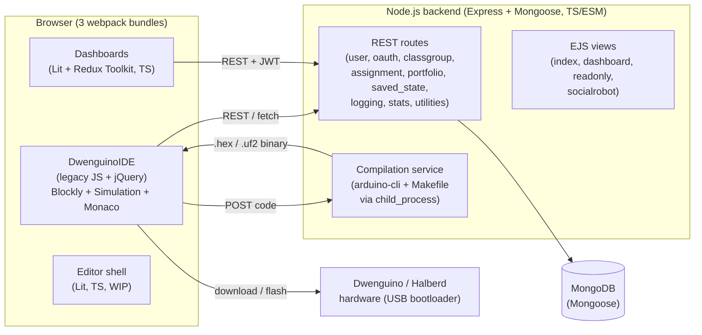
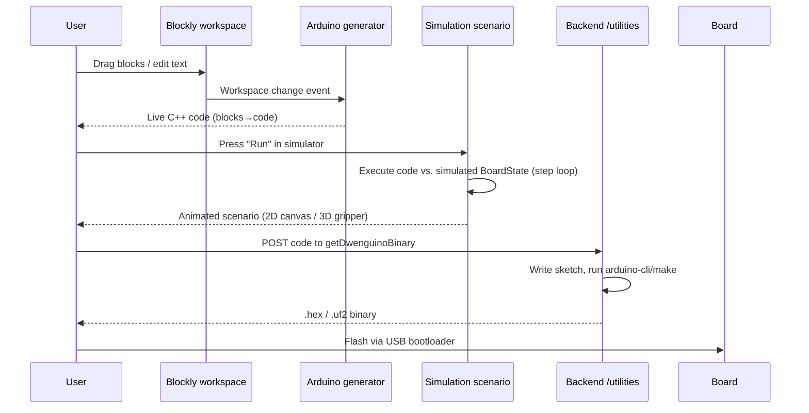

# Blockly-for-Dwenguino — Application Summary

*A senior-developer walkthrough of the codebase, produced as the foundation for building a
codebase-specific agent and a subsequent refactoring effort.*

---

## 1. What the application is

**Blockly-for-Dwenguino** (a.k.a. *Dwenguinoblockly*) is an online environment for **physical
computing education**. It lets learners program the **Dwenguino** board (an ATmega-based
Arduino-compatible board from [dwengo.org](https://dwengo.org)) and the **Halberd** board using
either **visual blocks** (Google Blockly) or **text** (Monaco / VS Code editor), simulate the
result **in the browser**, and optionally **compile and upload** real firmware to a physical board.

It is a **hybrid app**: the vast majority runs client-side in the browser; a Node.js backend
provides compilation, user accounts, classroom management, portfolios and logging. The two halves
can run independently.

### Headline features
- Block editor that generates Arduino/Dwenguino **C++** with **live block→code translation**.
- **In-browser simulation** with multiple pluggable *scenarios* (social robot, riding robot,
  plotter, spyrograph, conveyor, and a 3D **gripper** simulator).
- Predefined **tutorials** for classroom use.
- **Textual editor** (Monaco) as an alternative to blocks, with tabs and error logging.
- **Server-side compilation & upload** to the Dwenguino/Halberd board.
- **User accounts** with OAuth (LeerID, ACM, GitHub, plus a mock provider).
- **Teacher dashboards**: class groups, assignment groups, student teams, portfolios, saved programs.
- **i18n**: English, Dutch, French, German, Greek, Italian, Malay.

---

## 2. High-level architecture



### Two coding paradigms coexist (the central architectural tension)
| Area | Style | Notes |
|------|-------|-------|
| **DwenguinoIDE** (main IDE) | Legacy **ES5/ES6 + jQuery + Bootstrap**, a large global object | The oldest, largest, most feature-rich part. |
| **Dashboards** | Modern **Lit web components + Redux Toolkit**, TypeScript | Cleanly structured, slice-based state. |
| **Editor** | **Lit** shell, TypeScript | Newest, minimal, appears to be an in-progress rewrite direction. |
| **Backend** | **TypeScript, ESM, Express, Mongoose** | MVC-ish (routes → controllers → models). |

This split is the single most important thing to understand: the project is mid-migration from a
legacy jQuery IDE toward modern Lit/TS components, and refactoring should generally push in that
direction.

---

## 3. Repository layout

> ⚠️ Note the **double-nested folder**: the git root is `Blockly-for-Dwenguino/`, and the frontend
> source lives one level deeper in `Blockly-for-Dwenguino/Blockly-for-Dwenguino/`.

```
Blockly-for-Dwenguino/                 ← git root / workspace
├── backend/                           ← Express + Mongoose (TypeScript, ESM)
│   ├── index.ts / server.ts           ← DB connect + app bootstrap
│   ├── routes/ controllers/ models/   ← MVC
│   ├── middleware/ security/          ← JWT auth, roles, TLS cert
│   ├── compilation/                   ← arduino-cli + Makefile toolchain + bins
│   ├── config/ datatypes/ queries/ utils/ views/ msg/
│   └── tsconfig.json
├── Blockly-for-Dwenguino/             ← FRONTEND (nested)
│   ├── DwenguinoIDE/js/src/           ← main IDE (legacy JS)
│   ├── dashboards/js/src/             ← Lit + RTK dashboards (TS)
│   ├── editor/js/src/                 ← Lit editor shell (TS, WIP)
│   ├── blockly/                       ← vendored Blockly + custom blocks/generators
│   ├── closure-library/
│   └── *.ejs / *.html                 ← page templates
├── shared/                            ← types & constants shared FE↔BE
├── msg/                               ← top-level i18n
├── tests/                             ← unit (jest) + end_to_end (puppeteer)
├── deploy/                            ← deploy.sh, docker_deploy.sh
├── docs/ documentation/              ← generated JSDoc + notes
├── webpack.config.cjs / .dev.cjs      ← 3-bundle build
└── package.json                       ← scripts, deps
```

---

## 4. Backend deep-dive (`backend/`)

**Stack:** Express 4, Mongoose 9, TypeScript (ESM), JWT auth, Helmet/CSP, cookie-session, CORS.

- **Bootstrap** — `index.ts` connects to MongoDB (`MONGODB_URI`), optionally drops/seeds mock data
  in development, then starts the HTTP server. `server.ts` builds the Express app: view engine
  (EJS), production hardening (compression + Helmet CSP), body parsing, cookie parsing, and mounts
  all routers. Port is **hardcoded to `12032`**; SSL port from env.
- **Routing → Controllers → Models (MVC):**
  - `routes/` — `blockly`, `dashboard`, `oauth`, `user`, `classgroup`, `assignmentgroup`,
    `portfolio`, `saved_state`, `logging`, `stats`, `utilities`.
  - `controllers/` — one per domain plus an OAuth family: `abstract.oauth.controller` with
    concrete `acm`, `github`, `leerid`, and `mock` implementations.
  - `models/` — Mongoose schemas: `user` (+ `role`), `class_group`, `assignment_group`,
    `student_team`, `portfolio` (+ `portfolio_items/`), `saved_state`, `logitem`.
- **Auth & security** — `middleware/authJwt.ts`, `verifySignUp.ts`, `middleware.ts`
  (`verifyTokenAjax`, `verifyUserExists`, `roleCheck("teacher")`). `security/` holds TLS cert/key.
- **Compilation service** — `controllers/util.controller.ts` is the heart of hardware support:
  1. Receives generated C++ (`getDwenguinoBinary` / `getHalberdBinary`).
  2. Writes it to `compilation/sketch-<random-id>/`.
  3. Invokes the Arduino toolchain (`arduino-cli` / `make`) via `child_process.exec` using bundled
     binaries in `compilation/bin/{linux,windows}` and libraries in `compilation/libraries`.
  4. Returns a board-flashable binary (`.hex` for the Dwenguino USB bootloader, `.uf2` for Halberd).
- **Views** — EJS templates (`index.ejs`, `dashboard.ejs`, `readonly.ejs`, `socialroboteditor.ejs`)
  are served for the SPA entry points.

---

## 5. Frontend deep-dive

### 5a. DwenguinoIDE — the main IDE (`DwenguinoIDE/js/src/`)
The largest and oldest part. Written mostly in **plain JS with jQuery/Bootstrap**.

- **`dwenguino_blockly.js`** — the entry point and a large global object `DwenguinoBlockly` that acts
  as a *god object*: it holds editor state (`workspace`, `simulatorState`, current board, current
  programming context "blocks" vs "text"), wires up all menu buttons, and owns save/load/upload/
  download plus autosave-to-cloud logic.
- **`simulation/`** — the simulation engine:
  - `dwenguino_simulation.js` registers all scenarios and owns the current one.
  - `simulation_controls_controller.js`, `base_simulation_runner.js`, `simulation_runner.js`,
    `board_state.js`, `simulation_sandbox.js` (runs generated code against a simulated board state).
- **`scenario/`** — a **pluggable scenario system**. Each scenario extends
  `DwenguinoSimulationScenario` (init state, init display, `updateScenario(state)` step function):
  - `socialrobot/` — **2D canvas** robot with a component factory (`robot_components_factory.js`) and
    a rich `components/` library (led, rgbled, ledmatrix, servo, continuous/base servo, lcd, buzzer,
    sonar, pir, light/sound/touch sensors, button). Uses an `event_bus` and draggable components.
  - `gripper/` — a **3D kinematics simulator** built on Three.js: `KinematicsEngine`,
    `ConstraintSolver`, `ModelLoader` (GLB/GLTF + DRACO), `ThreeSceneManager`, `TouchSensorManager`,
    `GraspableObject`, driven by JSON **kinematics descriptors**. This is an **actively developed
    area** — see root docs `KINEMATICS_DESCRIPTOR_GUIDE.md`, `PER_ENTITY_WEIGHTS_*`,
    `ROTATION_GAIN_TUNING.md`, and the many markdown notes inside `gripper/`.
  - `ridingrobot/`, `spyrograph/`, `plotter/`, `conveyor/` — additional 2D scenarios.
- **`textual_editor/`** — a Monaco wrapper: `editor_pane.ts`, `tab_info.ts`, `error_log.ts`,
  `layout_config.ts`, `dwenguino_code_samples.ts`. Emits "has become unsaved" events back to the IDE.
- **Supporting modules** — `logging/` (event logger + event names), `user/` (cookie consent/info),
  `utils/` (`file_io_controller.js`, `bindmethods.js`), `graphics_lib/` (`point.js`, `line.js`).

### 5b. Dashboards — teacher/student portal (`dashboards/js/src/`)
A **modern, cleanly-structured** SPA and the reference for where the codebase is heading.

- **`dashboard.ts`** — root `LitElement` using `@lit-labs/router`, connected to a Redux store via
  `pwa-helpers`, localized with `@lit/localize`.
- **`components/`** — feature areas: `classes/`, `assignments/`, `portfolios/`, `savedstates/`,
  `user/`, plus `header`, `menu`, `intro_page`, `notify`.
- **`state/`** — Redux Toolkit `store.ts` + `features/*_slice.ts` (user, class_group,
  student_class_group, assignment_group, student_team, portfolio, public_profile, saved_state,
  log_item, oauth, notification). Async thunks call the backend REST API with JWT.
- **`localization/`, `middleware/`, `styles/`, `util.ts`**.

### 5c. Editor — newer shell (`editor/js/src/`)
A minimal **Lit** app (`editor.ts` renders `<dwengo-editor-menu>`). Appears to be an in-progress
next-generation editor shell; currently small.

### 5d. Blockly integration (`Blockly-for-Dwenguino/blockly/`)
A **vendored copy of Google Blockly** (Closure-based) with project-specific additions:
- **`blocks/`** — custom block definitions: `dwenguino_new.js`, `drawingrobot.js`, `conveyor.js`,
  `arduino.js`, `output_actuators.js`, `input.js`, plus standard categories.
- **`generators/arduino/`** — **C++ code generation**. `dwenguino.js` maps blocks to Dwenguino/
  Arduino C++ (e.g. `setup_loop_structure` emits `#include`s + `initDwenguino()`, `dc_motor`,
  `dwenguino_lcd`, `set_leds`). This is what powers live block→code translation.

---

## 6. Shared code & i18n

- **`shared/types/`** — TypeScript types/constants shared between frontend and backend
  (`user.ts`, `portfolio.ts`, `saved_state.ts`, `saved_state.types.ts` with the `SCENARIO` enum,
  `log_item.ts`). Currently used by dashboards and the simulation scenario-name mapping; the legacy
  IDE largely does **not** consume these yet.
- **Localization** — `msg/{en,nl}.json` at root, plus per-app `msg/` folders and `@lit/localize`
  XLIFF for dashboards. Languages: en, nl, fr, de, el, it, ms.

---

## 7. Build, run & test

- **Module system:** ESM (`"type": "module"`), Node ≥ 16.
- **Frontend build:** webpack produces **three bundles** — `simulator` (DwenguinoIDE),
  `dashboards`, `editor` — via babel + `ts-loader` (`webpack.config.cjs` prod,
  `webpack.config.dev.cjs` dev). Monaco is bundled via `monaco-editor-webpack-plugin`.
- **Backend build:** `tsc --project backend/tsconfig.json` → `backend/dist/`.
- **Scripts:** `npm run build` / `build-dev`; `npm start` runs `backend/dist/backend/index.js`.
- **Tests:** Jest (`jsdom` + `mongodb-memory-server`) for unit tests (`tests/unit/`), Puppeteer for
  end-to-end (`tests/end_to_end/`). `npm test` runs frontend + backend suites.
- **Deploy:** `deploy/deploy.sh` (Linux) and `deploy/docker_deploy.sh`.
- **Git:** default branch `unified`; active development on `develop`.

---

## 8. Data & control flow (typical "write, simulate, flash" loop)



Accounts/persistence flow (dashboards & saved programs) is separate: the Lit dashboards and the IDE
call JWT-protected REST endpoints (`/user`, `/savedstate`, `/portfolio`, `/classgroup`, …) which read/
write MongoDB via Mongoose.

---

## 9. Senior-developer observations & refactoring targets

These are candidate areas for the later cleanup/DRY/readability and UI-revamp phases:

**Architecture / consistency**
- **Two paradigms** (legacy jQuery god-object vs. modern Lit/RTK). Converging the IDE toward the
  Lit/TypeScript component model used by `dashboards`/`editor` is the biggest structural win.
- `DwenguinoBlockly` mixes **state, persistence, UI wiring, and board selection** in one global
  object — a prime candidate for decomposition (state store, persistence service, UI controllers).
- The **double-nested `Blockly-for-Dwenguino/Blockly-for-Dwenguino/`** path and duplicate tsconfigs
  (`tsconfig.json`, `dashboards.tsconfig.json`, `DwenguinoIDE.tsconfig.json`, `tsconfigold.json.txt`)
  add friction; consolidating the build config would help.

**Type safety & DRY**
- The legacy IDE barely uses `shared/types`; migrating shared models (saved state, scenarios, user)
  to TypeScript and reusing `shared/` across FE & BE would remove duplication.
- Scenario classes share a lot of boilerplate around state/display init — an opportunity for a
  cleaner base-class contract.

**Backend**
- `util.controller.ts` uses `child_process.exec` on paths derived from request data, manual random
  IDs, and hand-rolled fs handling — **review for command-injection/path-traversal safety**, and DRY
  up the Dwenguino/Halberd variants.
- Commented-out middleware (mongo-sanitize) and code blocks in `server.ts` should be resolved.

**Housekeeping**
- Numerous **design-note markdown files** at the repo root and inside `gripper/`, plus `.bak` files
  (`dwenguino_simulation_scenario_gripper.js.bak`) and `tsconfigold.json.txt`, should be organized
  into `documentation/` or removed.
- Generated `docs/` (JSDoc) is checked in and large.

**UI/UX (for the revamp phase)**
- The IDE UI is jQuery/Bootstrap-era; the dashboards use Vaadin + Material web components. A UI
  revamp could standardize on the modern component set for a consistent look and feel.

---

## 10. Quick reference — where to find things

| I want to… | Look in |
|------------|---------|
| Add/adjust a block | `Blockly-for-Dwenguino/blockly/blocks/` |
| Change generated C++ | `Blockly-for-Dwenguino/blockly/generators/arduino/` |
| Work on the main IDE behavior | `Blockly-for-Dwenguino/DwenguinoIDE/js/src/dwenguino_blockly.js` |
| Add/modify a simulation | `DwenguinoIDE/js/src/scenario/<scenario>/` |
| Work on the 3D gripper | `DwenguinoIDE/js/src/scenario/gripper/` (+ root kinematics docs) |
| Textual (Monaco) editor | `DwenguinoIDE/js/src/textual_editor/` |
| Teacher/student dashboards | `dashboards/js/src/` (components + `state/features`) |
| Backend API endpoint | `backend/routes/` → `backend/controllers/` → `backend/models/` |
| Auth / roles | `backend/middleware/`, `backend/controllers/oauth.*` |
| Compilation / upload | `backend/controllers/util.controller.ts`, `backend/compilation/` |
| Shared types | `shared/types/` |
| Translations | `msg/`, per-app `msg/`, dashboards XLIFF |
```
