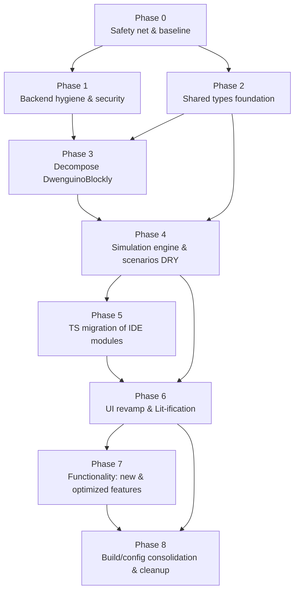

# Refactoring Plan — Blockly-for-Dwenguino

*A phased, safety-first plan to make the codebase cleaner, DRYer, more efficient, more readable, and
better typed — while migrating the legacy IDE toward the project's modern Lit + TypeScript direction.
Pairs with [APPLICATION_SUMMARY.md](APPLICATION_SUMMARY.md), [AGENTS.md](AGENTS.md), and the
`refactor-dwenguino` skill.*

---

## 0. Guiding principles

1. **Behavior-preserving first.** Each refactor keeps runtime behavior identical. Behavior changes
   (UI revamp, new features) are done as *separate, explicitly-scoped* steps — never mixed into a
   "pure refactor".
2. **Small, verifiable increments.** Prefer many small extractions with a green build/test between
   them over one big rewrite. Every step ends with `get_errors` + the narrowest relevant build/test.
3. **Migrate toward the modern style.** New/refactored code → TypeScript, small single-responsibility
   modules, `shared/types/`, Lit components + observable/Redux state over jQuery globals.
4. **Preserve public contracts.** REST route paths, Blockly block IDs, generated C++, saved-state
   schema (`shared/types/saved_state.types.ts`), and i18n keys stay stable unless a task targets them.
5. **Guardrails stay up.** No weakening of auth/Helmet/CSP; the compilation `exec` paths get *hardened*,
   not simplified away. No destructive git without explicit sign-off.
6. **Characterize before you change.** Add a characterization test (or a manual smoke checklist) for
   any legacy module before restructuring it, so regressions are caught.

---

## 1. Current-state assessment (why this plan)

**Hotspots by size (source lines, excluding `dist/` and vendored):**

| Lines | File | Concern |
|------:|------|---------|
| 1436 | `DwenguinoIDE/js/src/dwenguino_blockly.js` | God-object: state + persistence + UI wiring + board select |
| 999 | `scenario/socialrobot/robot_components_factory.js` | Large factory, likely repetitive per-component code |
| 941 | `scenario/socialrobot/simulation_canvas_renderer.js` | Monolithic renderer |
| 808 | `scenario/conveyor/conveyor_descriptor…` | Large data/descriptor blob |
| 460 | `simulation/simulation_controls_controller.js` | Mixed control + state |
| 441 | `simulation/simulation_sandbox.js` | Code execution sandbox |
| 437 | `scenario/socialrobot/dwenguino_simulation_scenario_social_robot.js` | Scenario logic |
| 258 | `backend/controllers/util.controller.ts` | Callback-nested compilation, shell-string `exec` |

**Structural debt:**
- **Two paradigms**: legacy jQuery IDE vs. modern Lit/RTK dashboards + editor shell.
- **God-object** `DwenguinoBlockly` couples unrelated concerns and is referenced globally (incl. inline
  HTML handlers), making it hard to test.
- **Scenario duplication**: each `DwenguinoSimulationScenario` subclass repeats init/display/save
  boilerplate; the base class is thin.
- **Compilation controller**: `getDwenguinoBinary` and `getHalberdBinary` are near-duplicate,
  deeply nested callback pyramids using `exec` with concatenated shell strings.
- **Config sprawl**: `tsconfig.json`, `DwenguinoIDE.tsconfig.json`, `dashboards.tsconfig.json`,
  `dev.dashboards.tsconfig.json`, `dev.editor.tsconfig.json`, plus `tsconfigold.json.txt`.
- **Housekeeping**: design `.md` notes at repo root and in `gripper/`, a `.js.bak`, commented-out
  middleware in `server.ts`.
- **Type gaps**: legacy IDE barely consumes `shared/types/`; lots of untyped `.js`.

---

## 2. Phase overview & sequencing

Phases 1 and 2 are independent and can run in parallel after Phase 0. Phase 3 is the keystone; most
later work depends on it. Phases 6 (UI) and 7 (functionality) are the behavior-changing phases and
build on the clean seams created by Phases 3–5. Phase 8 (config/cleanup) is low-risk and can be
pulled earlier opportunistically.

---

## Phase 0 — Safety net & baseline *(enabler, do first)*

**Goal:** be able to detect regressions before touching anything.

- **0.1** Record baseline build/test status: `npm run build-dev`, `npm run test-backend`,
  `npm run test-frontend`. Capture current failures so they aren't blamed on refactors.
- **0.2** Inventory the existing test coverage (`tests/unit`, `tests/integration`, `tests/end_to_end`)
  and note which modules are covered vs. bare.
- **0.3** Write a **manual smoke checklist** for the IDE's critical flows (load workspace, block→code,
  run simulation per scenario, save/load to account + localStorage, upload, download, compile
  Dwenguino + Halberd, switch board, switch blocks↔text, language switch).
- **0.4** Add **characterization tests** for the highest-risk pure logic first: the Arduino code
  generator output for a few representative programs (locks the generated-C++ contract), and
  `board_state` / `simulation_sandbox` behavior.
- **0.5** Establish a working branch strategy (feature branches off `develop`; no direct pushes to
  `unified`).

**Exit criteria:** green (or known-state) baseline; smoke checklist exists; generator characterization
tests pass.

---

## Phase 1 — Backend hygiene & security *(high value, contained)*

**Goal:** clean, DRY, safer backend without changing the API surface.

- **1.1 Harden the compilation service** (`backend/controllers/util.controller.ts`):
  - Replace `child_process.exec(<concatenated shell string>)` with `execFile`/`spawn` + argument
    arrays (no shell interpolation) for `arduino-cli`, `make`, `uf2conv.py`, `package.sh`, `ln`, `cp`,
    `rm`. Eliminates shell-injection surface even though `objid` is currently server-generated.
  - Validate/normalize `objid` (already `makeid(20)`, but assert charset) and confirm all paths stay
    within the `compilation/` sandbox (path-traversal defense-in-depth).
  - Bound resource usage (timeout is 10s; add output size caps) and ensure `cleanupCompile` always runs
    (finally-style), including on `res.download` error.
  - Replace verbose `console.log(code)` of user programs with guarded/redacted logging.
- **1.2 DRY the two binary generators** (`generateBinaryDwenguino` vs `generateBinaryHalberd`):
  extract a shared "prepare sketch dir → compile → post-process → download → cleanup" pipeline
  parameterized by board (toolchain command, fqbn/make target, post-processing step, output name).
  Convert the callback pyramids to `async/await` with `child_process` promisified.
- **1.3 Resolve `server.ts` dead code**: decide on the commented-out `mongo-sanitize` middleware —
  either enable a working sanitizer or remove the block; document the decision. Verify Helmet/CSP stays intact.
- **1.4 Controller/route consistency**: standardize error responses (the compile path returns a
  200 + attachment "error.log"; align on a consistent contract or document why it differs for downloads).
  Type `req`/`res` handlers (`Request`/`Response`), remove `any` where trivial.
- **1.5 Type the models & controllers** more strictly where low-risk; ensure `shared/types/` are the
  single source for user/portfolio/saved-state shapes.

**Verify:** `npm run build-dev-backend` + `npm run test-backend`; manual compile smoke for both boards.
**Risk:** medium (touches hardware compile path) → covered by manual smoke + careful arg-array porting.

---

## Phase 2 — Shared-types foundation *(enabler for FE work)*

**Goal:** one source of truth for data shapes across FE ↔ BE.

- **2.1 Audit `shared/types/`** (`user`, `portfolio`, `saved_state`, `saved_state.types`, `log_item`)
  and note the `.js`/`.js.map` build artifacts checked in alongside `.ts` — decide whether to gitignore
  the generated outputs.
- **2.2 Define/centralize IDE-facing types**: the saved-state payload, scenario names/enum
  (`SCENARIO`), board identifiers (`dwenguino`/`halberd`), programming context (`blocks`/`text`) —
  as TS types in `shared/`.
- **2.3 Replace ad-hoc string literals** (board keys, scenario keys, context) with the shared
  constants/enums in new code, so later phases consume them instead of magic strings.

**Verify:** `npm run build-dev` (both sides compile against shared types).
**Risk:** low.

---

## Phase 3 — Decompose `DwenguinoBlockly` *(keystone)*

**Goal:** break the 1,436-line god-object into cohesive, testable services while keeping the global
entry points other code relies on.

Approach: introduce services *behind* the existing `DwenguinoBlockly` facade, delegate to them, then
thin the facade. Do **not** remove the global surface in one go (inline handlers depend on it).

- **3.1 Extract `EditorStateStore`**: current board, `simulatorState`, `currentProgrammingContext`,
  saved-in-cloud / saved-in-localstorage flags, loaded XML — with change events. Facade reads/writes
  delegate here.
- **3.2 Extract `PersistenceService`**: save/load/autosave to account + localStorage, the 5s autosave
  interval, upload (`FileIOController`), download, and the "save to profile" modal orchestration.
  Preserve exact autosave timing and the `beforeunload` unsaved-guard semantics.
- **3.3 Extract `BoardManager`**: board registry (`dwenguino`/`halberd`), board selector wiring,
  compilation route mapping. Consume shared board types from Phase 2.
- **3.4 Extract `ProgrammingContextController`**: blocks↔text switching, syncing Blockly XML ↔ Monaco,
  and the "has become unsaved" listener wiring to `textualEditor`.
- **3.5 Extract `IdeUiController`**: jQuery menu/button bindings, resizable panels, simulator toggle,
  cookie-consent display. Keep DOM IDs identical.
- **3.6 Thin the facade**: `dwenguino_blockly.js` becomes a small composition root that instantiates
  the services and exposes the minimal global API still referenced externally.

**Verify (each sub-step):** `npm run build-dev-frontend` (simulator bundle) + smoke checklist items
for the touched flow. Add unit tests for extracted services (now testable in isolation).
**Risk:** high (central module, global refs) → mitigated by facade-delegation pattern and per-step smoke.

---

## Phase 4 — Simulation engine & scenario DRY

**Goal:** remove duplication across scenarios and shrink the socialrobot monoliths.

- **4.1 Strengthen `DwenguinoSimulationScenario`** base: pull shared boilerplate (state-changed
  listeners, container clearing, common lifecycle) up; define a clear contract
  (`initSimulationState`, `initSimulationDisplay`, `updateScenario`, save/restore). Keep each
  subclass's *observable behavior* identical.
- **4.2 Refactor `robot_components_factory.js` (999 lines)**: replace the large switch/if construction
  with a **registry map** of component-type → constructor; each component already lives in
  `components/`. Removes repetition and makes adding components declarative.
- **4.3 Split `simulation_canvas_renderer.js` (941 lines)**: separate rendering concerns (layout,
  per-component draw, hit-testing/drag) into smaller modules.
- **4.4 Extract conveyor descriptor data** (808 lines) into a data module/JSON, separated from logic.
- **4.5 Clean `simulation_controls_controller.js` / `simulation_sandbox.js`**: separate control flow
  from execution; type the board-state interface.
- **4.6 Gripper (3D/kinematics)** — *tread carefully, active development*: only cosmetic/readability
  and type additions; **no** behavioral change to `KinematicsEngine`/`ConstraintSolver`. Remove the
  `.js.bak` after confirming it's obsolete (ask first). Consolidate the many gripper `.md` notes into
  `documentation/`.

**Verify:** simulator bundle build + run each scenario from the smoke checklist.
**Risk:** medium (gripper high) → keep gripper changes minimal and reversible.

---

## Phase 5 — TypeScript migration of IDE modules

**Goal:** convert extracted/legacy `.js` to `.ts` incrementally, consuming shared types.

- **5.1 Convert the Phase-3 services** first (they're new and small) to `.ts`.
- **5.2 Convert leaf utilities** (`utils/`, `logging/`, `user/`, `graphics_lib/`) — low fan-in first.
- **5.3 Convert simulation core** (`board_state`, `base_simulation_runner`, `simulation_runner`,
  scenario base) with proper interfaces.
- **5.4 Tighten `tsconfig` strictness** progressively (`noImplicitAny`, then `strict`) per-folder via
  the appropriate tsconfig, fixing fallout in small batches.
- Keep webpack/babel handling of `.ts` intact; maintain explicit ESM import extensions where required.

**Verify:** `npm run build-dev-frontend` after each module; `get_errors` clean.
**Risk:** low–medium (build config edge cases).

---

## Phase 6 — UI revamp & Lit-ification *(behavior-changing — scope explicitly)*

**Goal:** modernize the IDE's look, feel, and structure and align it with the dashboards' component
system, done as deliberate, visible feature work (not a silent refactor). The current IDE shell
(`index.ejs`) is a jQuery/Bootstrap page: a `db_header` with a logo, a blocks↔code toggle switch,
a saved-notification, and a `db_menu` of Font-Awesome icon buttons (login, simulator, save,
download, upload, run, clear, board select, language select); a three-pane `db_main_content`
(`db_blockly` + injected `blocklyDiv`, `db_code_pane`, `db_infopane`/`db_simulator_panes`); Bootstrap
modals (upload dropzone, save-to-profile, etc.); Hopscotch tutorials; and DataTables. Font Awesome +
Hopscotch + `sb-admin-2` + hand-rolled `style.css` drive the styling.

> Do this **after** Phases 3–5 so UI islands sit on clean, typed seams. Migrate **island-by-island**,
> keeping the old and new UI switchable (feature flag / route) so the app always ships.

### 6a. Design foundation
- **6.1 Design system & tokens**: define a shared **design-token** layer (colors, spacing,
  typography, radius, elevation, dark-mode) as CSS custom properties, reconciling the IDE's
  `colors.css`/`style.css` with the dashboards' Vaadin/Material theme so both apps look like one
  product. Establish responsive breakpoints and accessibility baselines (focus states, contrast,
  keyboard nav, ARIA, `prefers-reduced-motion`).
- **6.2 Component-system decision**: standardize on **Lit + the Vaadin/Material web components**
  already in `package.json`; retire Bootstrap + jQuery UI + Hopscotch + DataTables incrementally.
  Document the chosen primitives (button, icon-button, dialog, select, tabs, tooltip, toast, grid).
- **6.3 Icon strategy**: replace Font-Awesome CSS classes with a single icon set (Vaadin/Material or
  inline SVG) exposed as a small `<dwengo-icon>` wrapper.

### 6b. Rebuild the IDE shell as Lit islands
- **6.4 App shell / layout**: recreate `db_header` + `db_main_content` as a Lit layout host
  (grow the existing `editor/` shell). Replace jQuery UI `resizable` and absolute-positioned
  `blocklyDiv` overlay with a robust CSS grid / split-pane component that handles Blockly's
  `svgResize` on layout change. Make the three-pane layout responsive/collapsible.
- **6.5 Top menu / toolbar** → `<dwengo-ide-toolbar>`: convert the icon buttons to accessible
  `mwc/vaadin` buttons with tooltips and labels; wire them to the Phase-3 services
  (`PersistenceService`, `BoardManager`, `ProgrammingContextController`) instead of inline jQuery
  handlers. Preserve every action (save/download/upload/run/clear/simulator/board/language).
- **6.6 Blocks↔Code toggle** → a proper segmented control bound to `ProgrammingContextController`,
  with clear active state and keyboard support.
- **6.7 Board & language selectors** → Lit `<select>` components fed by shared board/scenario/locale
  types; keep the same option values (contract).
- **6.8 Modals → Lit dialogs**: port the upload-dropzone and save-to-profile Bootstrap modals to
  `<dwengo-dialog>` (drag-and-drop upload, name entry). Replace ad-hoc modals app-wide.
- **6.9 Notifications**: unify the saved-notification, loading gear, and error surfacing into a single
  toast/status system (reuse the dashboards' `notify` component pattern).
- **6.10 Simulation controls & scenario picker** → `<dwengo-simulation-panel>`: modern controls
  (run/pause/step/reset/speed), a visual scenario selector, and a responsive canvas/3D host; bind to
  `simulation_controls_controller` seams from Phase 4.
- **6.11 Textual editor chrome**: modernize the Monaco tab bar / error-log surrounds (`textual_editor/`)
  to match the new design system while keeping Monaco itself intact.

### 6c. Cross-app consistency & polish
- **6.12 Unify header/login/menu** across IDE and dashboards (the `<dwengo-login-menu>` is already
  embedded in the IDE header — extend that pattern to the whole chrome).
- **6.13 Retire jQuery/Bootstrap per page** only once no code references them; drop the corresponding
  CSS/vendor files and shrink the bundle.
- **6.14 Visual QA**: verify each island for layout, responsiveness, dark mode, and a11y before
  switching it on by default.

**Verify:** per-island visual + functional smoke (every toolbar action still works, Blockly resizes,
simulation runs, save/load intact); keep old ↔ new switchable; check `get_errors` and bundle size.
**Risk:** high (user-facing) → island-by-island migration behind flags; preserve all action contracts.

---

## Phase 7 — Functionality: new & optimized features *(behavior-changing — scope explicitly)*

**Goal:** add and optimize user-facing functionality on top of the now-clean seams. Each item is its
own scoped change with tests and, where user-visible, a feature flag. Treat this as a **backlog** to
prioritize with stakeholders — not everything is mandatory. Group by theme:

### 7a. Editing & authoring
- **7.1 Robust autosave & recovery**: build on the Phase-3 `PersistenceService` — debounced autosave,
  offline queue, unsaved-changes indicator, and crash/restore from localStorage; surface save state
  clearly (replaces the current fixed 5s interval + basic flags).
- **7.2 Undo/redo & versioning**: consistent undo across blocks and text; optional local revision
  history for a saved program (leveraging `undo-manager` already in deps).
- **7.3 Block↔text round-trip UX**: clearer messaging and safeguards when switching contexts so users
  don't silently lose edits; optional two-way sync where feasible.
- **7.4 Code intelligence in Monaco**: Dwenguino/Arduino API completions, snippets
  (`dwenguino_code_samples`), inline diagnostics from a lightweight lint, and hover docs.

### 7b. Simulation & learning
- **7.5 Simulation UX**: adjustable speed, step-through, pause/resume, and a live board-state
  inspector (LEDs/servos/sensors) rendered from `board_state`.
- **7.6 Scenario gallery**: a visual picker with thumbnails/descriptions; make adding a scenario
  declarative (registry from Phase 4).
- **7.7 Tutorials revamp**: replace Hopscotch with a modern guided-tour/tutorial component integrated
  with the new UI; support the existing `tutorials/` content and classroom levels.
- **7.8 Gripper/3D enhancements** *(coordinate with active dev)*: performance (Three.js
  code-splitting, lazy load), and UX for the kinematics control panel — no kinematics behavior change
  without explicit scope.

### 7c. Accounts, classroom & sharing
- **7.9 Dashboard/portfolio enhancements**: filtering/search/pagination on classes, assignments,
  portfolios, and saved programs (extend the RTK slices); optimize N+1 backend queries in
  `queries/aggregation.ts`.
- **7.10 Sharing & read-only links**: polish the `readonly.ejs` flow — shareable program links,
  embeds, and "open a copy".
- **7.11 Teacher workflow**: bulk actions, assignment feedback, and class overview improvements.
- **7.12 i18n completeness**: audit all 7 locales for missing keys, add a language-detection default,
  and ensure new UI strings are localized (dashboards XLIFF + IDE `msg/`).

### 7d. Performance & platform
- **7.13 Bundle optimization**: code-split Monaco, Three.js/gripper, and per-scenario chunks; lazy
  load simulation scenarios; measure with a bundle analyzer.
- **7.14 PWA/offline**: optional service worker for offline editing/simulation (blocks + sim run
  without the backend), using the `pwa-helpers` already present.
- **7.15 Compilation UX**: progress/streaming feedback during compile+upload, clearer error surfacing
  (pair with the Phase-1 error-contract cleanup), and Web-Serial upload polish
  (`@tomneutens/serial_monitor`).
- **7.16 Telemetry/logging**: make the event logger opt-in/consented and useful for product insight
  without harming performance.

**Verify:** feature-level tests (unit + e2e where practical), a11y and performance checks; ship behind
flags and validate the relevant smoke-checklist flows.
**Risk:** medium–high (user-facing, some backend) → one feature per change, measure before/after.

---

## Phase 8 — Build/config consolidation & housekeeping *(low-risk, opportunistic)*

- **8.1 Consolidate tsconfigs**: define a base `tsconfig.base.json` and have per-app configs extend it;
  remove `tsconfigold.json.txt` (root and nested) after confirming nothing references them (**ask first**).
- **8.2 Rationalize webpack**: factor shared rules between `webpack.config.cjs` and `.dev.cjs`.
- **8.3 gitignore generated artifacts** (`shared/types/*.js`/`*.js.map`, `**/js/dist`, `backend/dist`,
  and generated `docs/`) if not needed in-repo.
- **8.4 Organize docs**: move root design notes (`KINEMATICS_DESCRIPTOR_GUIDE.md`,
  `PER_ENTITY_WEIGHTS_*`, `ROTATION_GAIN_TUNING.md`, `PER_ENTITY_WEIGHTS_EXAMPLES.js`) and gripper
  `.md` files into `documentation/`.
- **8.5 Remove `.bak` and dead code** (with confirmation): `dwenguino_simulation_scenario_gripper.js.bak`,
  commented-out blocks.
- **8.6 Linting/formatting**: adopt a single ESLint + Prettier config across FE/BE to lock in style.

**Verify:** full `npm run build-dev` + both test suites.
**Risk:** low.

---

## 3. Cross-cutting workstreams (run continuously)

- **Testing:** grow unit coverage as modules become testable (esp. Phase-3 services, generators,
  scenario base). Keep the puppeteer e2e smoke suite runnable.
- **Documentation:** update `APPLICATION_SUMMARY.md`, `AGENTS.md`, and `/memories/repo/architecture.md`
  as structure changes.
- **Security review:** revisit auth middleware, CSP, and the compile sandbox whenever adjacent code changes.
- **Performance:** watch bundle sizes (three webpack bundles) as modules move; prefer code-splitting
  for the heavy gripper/Three.js and Monaco chunks.

---

## 4. Suggested milestones

| Milestone | Contents | Definition of done |
|-----------|----------|--------------------|
| **M1 — Safe to refactor** | Phase 0 | Baseline recorded, smoke checklist, generator characterization tests green |
| **M2 — Clean backend** | Phase 1 (+ 2 started) | Compile service hardened & DRY (async, `execFile`), API unchanged, tests green |
| **M3 — Typed core** | Phase 2, Phase 5.1–5.2 | Shared types adopted in new code; leaf IDE utils in TS |
| **M4 — Decomposed IDE** | Phase 3 | `DwenguinoBlockly` split into services behind a thin facade; smoke green |
| **M5 — DRY simulation** | Phase 4 | Scenario boilerplate shared; socialrobot monoliths split; gripper untouched behaviorally |
| **M6 — Modern UI** | Phase 6 | Design tokens defined; toolbar/modals/selectors/simulation panel on Lit; jQuery/Bootstrap retired page-by-page; a11y + responsive verified |
| **M7 — Enhanced features** | Phase 7 | Prioritized feature backlog shipped behind flags (autosave/recovery, sim UX, tutorials, dashboard search, bundle split), each tested |
| **M8 — Consolidated** | Phase 8 | Single tsconfig base, tidy docs, lint/format enforced |

---

## 5. Risk register

| Risk | Where | Mitigation |
|------|-------|------------|
| Breaking generated C++ contract | Generators, board_state | Characterization tests on generator output (Phase 0.4) |
| Breaking save/load or autosave | Phase 3 persistence | Facade-delegation, keep timings/IDs, smoke checklist |
| Global refs from inline HTML handlers | Phase 3 UI | Keep global facade API until handlers migrated (Phase 6) |
| Compile path regressions (hardware) | Phase 1 | Manual compile smoke for both boards; port to arg-arrays carefully |
| Gripper kinematics regressions | Phase 4 | Minimal, reversible changes; no logic edits; keep active-dev owner in loop |
| UI regressions / lost toolbar actions | Phase 6 | Island-by-island behind flags; preserve every action contract; visual + functional smoke |
| Accessibility / responsive regressions | Phase 6 | a11y baseline in 6.1; keyboard/contrast/reduced-motion checks per island |
| Blockly overlay / resize breakage | Phase 6.4 | Robust split-pane; call `Blockly.svgResize` on layout change; test resize flows |
| Feature scope creep / half-built features | Phase 7 | One feature per change, feature-flagged; prioritize backlog with stakeholders |
| Backend load from new queries | Phase 7.9 | Optimize aggregation (avoid N+1), paginate, measure before/after |
| Webpack/tsconfig breakage | Phases 5, 8 | Change one config at a time; full `build-dev` after each |
| Scope creep (refactor + feature mixed) | All | Enforce Principle 1: separate, explicitly-scoped commits |

---

## 6. How to execute

Drive each task through the **Dwenguino Refactorer** agent
(`.github/agents/refactor.agent.md`) using the **refactor-dwenguino** skill's 6-step workflow
(Map → Baseline → Plan → Refactor → Verify → Report). Start with **Phase 0**, then take **Phase 1**
and **Phase 2** in parallel, converging on **Phase 3** as the keystone.

Recommended first concrete task: **Phase 1.1 + 1.2 — harden and DRY `util.controller.ts`** (high
value, well-contained, and it exercises the full workflow end-to-end).
